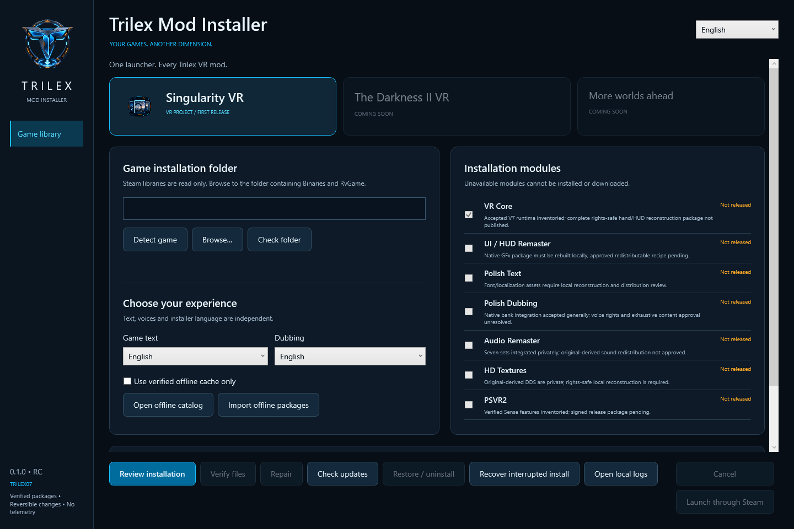

# Trilex Mod Installer

Windows launcher and modular installer by **Trilex / trilex07** for the [Singularity VR mod](https://github.com/trilex07/SingularityVR). The Darkness II VR is Coming Soon.



**[Download the complete V7 installer RC3](https://github.com/trilex07/TrilexModInstaller/releases/tag/installer-1.0.0-rc.3):** self-contained Windows installer, pinned signed catalog and 12 local packages matching Trilex's accepted configuration. RC3 fixes the clean Steam texture-cache reconstruction error and retains the fpsVR guard fix. Extract the entire ZIP and choose **Full Trilex V7 (Polish)**. [Installation instructions, PL/EN](docs/INSTALL-V7.md) · [RC3 correction and retry](docs/INSTALLER-RC3-CACHE-FIX.md). The executable is unsigned; clean-PC/PSVR2 installer acceptance remains pending.

## Public fan-project preview

Nieoficjalny, bezpłatny mod fanowski Trilexa. Kod pozostaje otwarty; nagrania i głosy
mają osobne pochodzenie i status. [Opis dystrybucji PL/EN](docs/DISTRIBUTION-NOTICE.md).

[Public source/audio-recipe preview 0.1.0](https://github.com/trilex07/TrilexModInstaller/releases/tag/installer-0.1.0-source-preview.1)
provides source and metadata-only local DSP recipes. It does **not** contain an
installer EXE, game recordings or a full installable mod catalog. See the
[source-preview notes](docs/SOURCE-PREVIEW-0.1.0.md) for the exact contents.

## Features

- Trilex dark desktop interface, supplied logo and icons, English/Polish UI.
- Steam library/appmanifest detection, manual folder validation, exact compatible EXE SHA-256.
- Game text/dubbing selectors synchronized with their module checkboxes. Accepted V7 does not support complete Polish movie voice with English text; this combination fails before writing. The complete candidate includes VR Core, UI/HUD, HD textures, local audio remaster, Polish dubbing/text, original-derived hand/TMD and reload assets, and the accepted preset.
- Full bundle: adjacent signed catalog and packages recognized automatically; no source checkout or external Python required. Windows DirectInput is sourced from the recipient's own x86 system directory, not redistributed or pinned to the developer's Windows patch level.
- Signed ECDSA P256 catalogs, immutable GitHub Releases URLs, exact versions/dependencies/sizes, SHA-256 verification, resumable cache, cancellation and offline imports.
- Strict ZIP allowlists; no archive links/traversal; local reconstruction recipes read verified owned originals. Downloaded scripts are never executed.
- Install/update/repair/uninstall, original backups, durable rollback journal and recovery after process termination. Three-way INI merge retains user settings. Unrelated files/mods are preserved; collisions stop installation.
- Process-in-use protection; the installer never terminates games. Steam launch is an explicit action available only for a managed compatible installation.

## Build and run

Windows x64 and .NET SDK 10.0.302 (or compatible newer 10.0 feature band):

```powershell
./scripts/build.ps1 -Publish
./artifacts/publish/TrilexModInstaller.exe
```

The publish is self-contained: the player does not need a separately installed .NET runtime. WPF trimming is disabled. Distribute `artifacts/publish/TrilexModInstaller-win-x64.zip`, which retains the installer and embedded runtime license notices. The local RC executable is **not Authenticode signed**; no publisher certificate has been provided. Do not bypass Windows security warnings. Production workflow refuses to publish without signatures.

That command builds the default source-preview bootstrap. Maintainers with the
reviewed private preparation inputs use `scripts/assemble-first-edition.ps1` for
the **complete mod bundle**, embedding its verified complete catalog. Do not call
the smaller engine-only ZIP the full V7 installation. Instructions and exact
publisher-review distinction: [first-edition decision](docs/distribution/FIRST-EDITION.md).

Building also requires Visual Studio C++ tools and the pinned Python dependencies
installed by the build script. The Centurion exporter uses a hash-pinned official
UE Viewer archive; `TRILEX_UEVIEWER_ARCHIVE` supplies it for offline builds. See
[extractor provenance](docs/distribution/UEVIEWER.md). The installer itself includes
its fixed image worker: players need no Python. Review checks the x86 VC++ runtime
without loading a DLL and links to the official Microsoft installer when absent.

App data: `%LOCALAPPDATA%/Trilex/ModInstaller`. Keep its `installations` folder: it contains original backups and recovery journals. Local logs contain no telemetry and replace the home path with a placeholder. `TRILEX_HOME` may redirect all installer state to a disposable test profile. No automatic writes to game directories occur on startup.

Select a compatible folder, choose text/voice and modules, then review before installing. Check updates refreshes the signed catalog; review/install applies it. Repair is explicit. Restore/uninstall restores backed-up originals while retaining external edits. Recover interrupted install is available before catalog/package downloads. A conflict or running game blocks writing. Administrator elevation is not automatic: access-denied errors leave a recoverable transaction; choose a user-writable Steam library or explicitly restart the trusted signed installer with appropriate permissions.

## Repository layout

- `src/Trilex.Installer.Core`: catalog, adapters, downloader, extraction, recipes, transactions.
- `src/Trilex.Installer.Desktop`: WPF, localization, Steam process guard, offscreen smoke tests.
- `src/Trilex.Installer.Tools`: offline catalog signing/verification and audited package creation.
- `tests`: synthetic regression harness; no game executable or commercial content.
- `inventory/singularity-v7.json`: all 164 accepted file pins and 381 INI keys, source/ownership/gates.
- `catalog`: embedded signed bootstrap and public trust pin. **Never commit private keys.**
- `docs/PACKAGES.md`, `docs/SECURITY.md`, `docs/STATUS.md`: publishing contract, safeguards and evidence.

To add a game, implement `IGameAdapter`, register its adapter and UI selection, add compatible fingerprints and reviewed signed module manifests, then run fixtures. `Darkness2GameAdapter` intentionally refuses installation until supported. The current UI's enabled game is Singularity; the package/transaction infrastructure is shared.

## Distribution

Source is separate from release assets. CI builds/tests; the manually dispatched production workflow creates a **draft RC** only and requires an existing pinned catalog key plus Authenticode certificate. Module packages must pass rights/content audit and use immutable release URLs before a catalog marks them stable. The latest public non-prerelease installer release must contain `catalog.signed.json`; the app resolves its immutable asset URL and verifies the pinned signature. No release endpoint is assumed published by this source checkout.

Commercial originals, extracted PSK/DDS/audio, cooked `.xxx` packages and private generation outputs are excluded. A native/encrypted format does not grant redistribution rights. See the inventory for per-component gates. General PSVR2 acceptance of V7 is preserved separately from distribution approval and exhaustive audio/level testing.

Code copyright © 2026 Trilex, MIT. User-supplied branding/reference kit has separate provenance; game content and external runtime libraries retain their original licenses. See [THIRD-PARTY-NOTICES.md](THIRD-PARTY-NOTICES.md).

Optional sound remaster can be generated locally from SHA-verified owned audio,
without distributing recordings. See [local audio and voice provenance](docs/distribution/LOCAL-AUDIO.md).
Dubbing reference permissions are not independently verified. The full candidate
records Trilex's separate fan-mod publication approval while retaining
`rightsVerified=false`, and discloses this before installation. MIT applies to our
code, not the game's recordings or third-party materials. See the
[publisher decision](docs/distribution/FIRST-EDITION.md).
